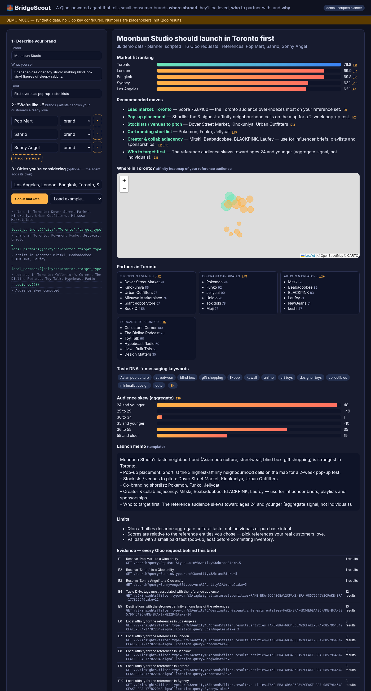

# 🌉 BridgeScout — where in the world will your brand be loved?

**An agent for small consumer brands going abroad.** Tell it what your customers
already love ("we're like Pop Mart + Sanrio"), and BridgeScout uses **Qloo's
cultural taste graph** to answer the questions a $20k market-research study
would: *which city first, which neighbourhood for the pop-up, which shops to
pitch, which brands to co-brand with, which artists/podcasts sit next to your
audience, and who that audience is.* Every claim links to the exact Qloo
request behind it.

> Built for the [Qloo Agentic Hackathon](https://qloo.devpost.com/) (Sept 30 – Oct 30, 2026).



## Why this needs Qloo (and fails without it)
An LLM alone will say "launch in Los Angeles" for every Asian lifestyle brand.
BridgeScout instead measures, per city, how strongly the local population
over-indexes on your reference entities, then maps that affinity down to
neighbourhood heatmap cells and cross-domain partners (places, brands, artists,
podcasts). Swap the references and the answer changes — because taste changes.

## The problem
Thousands of Chinese and Southeast-Asian DTC brands (designer toys, tea,
snacks, beauty, apparel) are going global ("出海"). The winners (Pop Mart,
HEYTEA, Chagee…) pick markets and partners with expensive local research.
Small studios guess, burn inventory on the wrong city, and pitch the wrong
stockists. BridgeScout gives them a defensible, evidence-backed first move.

## How the agent works
```
user brief ──► planner (LLM tool-calling loop, or scripted fallback)
                 │
                 ├─ resolve_references   GET /search                  (names → Qloo entity IDs)
                 ├─ taste_dna            GET /v2/insights filter.type=urn:tag
                 ├─ suggest_markets      GET /v2/insights filter.type=urn:entity:destination
                 ├─ score_markets        GET /v2/insights filter.results.entities=<refs> + signal.location.query=<city>
                 ├─ hotspots             GET /v2/insights filter.type=urn:heatmap + filter.location.query=<city>
                 ├─ local_partners       GET /v2/insights filter.type=place|brand|artist|podcast (+ location)
                 └─ audience             GET /v2/insights filter.type=urn:demographics
                 ▼
          launch brief (ranked markets, map, partners, keywords, cited memo, evidence table)
```
* **Agentic:** with `LLM_API_KEY` set, an OpenAI-compatible model chooses tools,
  cities and partner types itself (`bridgescout/agent.py`). Missing essentials
  are back-filled so the brief is always complete; if the LLM fails, the
  scripted planner takes over.
* **Provenance:** every Qloo call is logged as evidence `E1…En`; the memo must
  cite them, and the UI links each recommendation to its request.
* **Responsible use:** only aggregate brand/entity signals are sent to Qloo —
  no personal data. Limits are shown in every brief.

## Run locally
```bash
python3 -m venv .venv && . .venv/bin/activate
pip install -r requirements-dev.txt
cp .env.example .env   # add QLOO_API_KEY (and optionally LLM_API_KEY)
set -a; . ./.env; set +a
uvicorn bridgescout.app:app --reload --port 8000
# open http://localhost:8000  (add ?autorun=1 to run the first example)
pytest -q
```
Without `QLOO_API_KEY` the app runs in clearly-labelled **DEMO mode** with
synthetic data (for UI development and tests only).

## Deploy (Render free tier)
`render.yaml` + `Dockerfile` are included: New → Blueprint → pick this repo,
set `QLOO_API_KEY` (and optional `LLM_*`) as secrets. The browser never sees a key.

## Configuration
| Variable | Default | Notes |
| --- | --- | --- |
| `QLOO_API_KEY` | – | Hackathon key; empty → demo mode |
| `QLOO_BASE_URL` | `https://hackathon.api.qloo.com` | Hackathon keys only work here |
| `LLM_API_KEY` / `LLM_BASE_URL` / `LLM_MODEL` | – / OpenAI / `gpt-4o-mini` | Any OpenAI-compatible provider |

## Limitations
Qloo affinities are aggregate cultural signals, not purchase intent or
individual preferences; scores are relative to the references you choose.
Use the brief to pick a cheap first test, not to bet the company.

## License
MIT — see [LICENSE](LICENSE).
